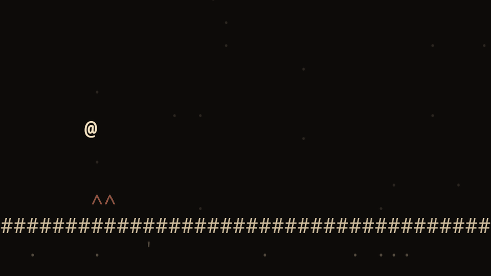

# VIXE

**English** · [Português](README.pt-BR.md)

A ~210 KB platformer made entirely of text. Inspired by *Level Devil*.

**Play it at <https://vixe.online>**

[](https://github.com/thiagorodriguesdutra/vixe/actions/workflows/ci.yml)



40 levels across 5 worlds, and maybe something else tucked away. Play with a keyboard, a
gamepad or a touchscreen, and install it as an app on your phone. The game uses no images,
fonts or libraries. Everything is drawn with characters and every sound is synthesized on
the fly.

## Running it

Any static server will do. With Python it's a single line.

```sh
python -m http.server 8000
```

Then open <http://localhost:8000> in your browser. Opening `index.html` straight from disk
won't work, because the browser blocks the level files from loading.

Arrows or WASD to move, space to jump, Esc to pause and R to restart the level.

## Making levels

A level is a drawing made of text. `#` is a wall, `@` is where you start, `>` is the exit
and `^` is a spike. What you type in the map is exactly what shows up on screen.

```json
"map": [
  "",
  "   @         ^^^          >",
  "##############################"
]
```

Traps are just data too. This event makes block group `a` shake and fall when the player
steps into zone `A`.

```json
{ "when": { "zone": "A" }, "do": [ { "wobble": "a" }, { "fall": "a" } ] }
```

New levels ship as packs. Make a folder in `assets/packs/`, put a `pack.json` listing your
worlds in it, and add the folder name to `assets/packs/manifest.json`. If a pack has an
error, the game skips it and keeps running. The main campaign is a pack like any other, so
`assets/packs/base/` doubles as a complete example.

To jump straight to a level, add `?dev&play=w1.1` to the URL, swapping `w1.1` for the world
and level number. Every tile, event and the music format are covered in
[docs/packs.md](docs/packs.md).

## License

[MIT](LICENSE)
