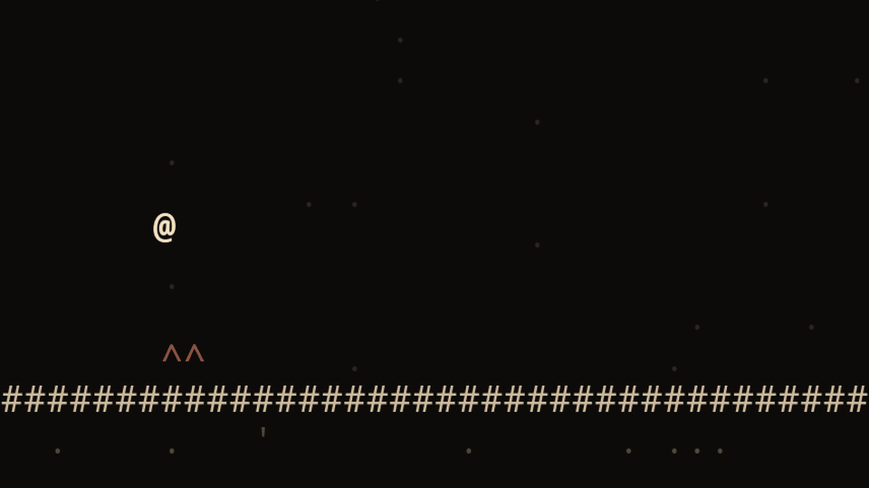

# VIXE

[English](README.md) · **Português**

Um jogo de plataforma de ~180 KB feito só de texto. Inspirado em *Level Devil*.

**Jogue em <https://vixe.online>**

[](https://github.com/thiagorodriguesdutra/vixe/actions/workflows/ci.yml)



São 32 fases em 4 mundos, e talvez mais alguma coisa escondida. Dá para jogar no teclado,
no controle ou no toque, e no celular ele pode ser instalado como app. O jogo não usa
nenhuma imagem, fonte ou biblioteca. Tudo é desenhado com caracteres e todo som é
sintetizado na hora.

## Como rodar

Basta servir a pasta do jogo com qualquer servidor estático. Com Python fica assim.

```sh
python -m http.server 8000
```

Depois abra <http://localhost:8000> no navegador. Abrir o `index.html` direto do disco não
funciona, porque o navegador bloqueia o carregamento das fases.

Setas ou WASD andam, espaço pula, Esc pausa e R reinicia a fase.

## Crie suas fases

Uma fase é um desenho em texto. `#` é parede, `@` é onde você começa, `>` é a saída e `^`
é espinho. O que você escreve no mapa é exatamente o que aparece na tela.

```json
"map": [
  "",
  "   @         ^^^          >",
  "##############################"
]
```

As armadilhas também são só dados. Este evento faz o grupo de blocos `a` tremer e cair
quando o jogador entra na zona `A`.

```json
{ "when": { "zone": "A" }, "do": [ { "wobble": "a" }, { "fall": "a" } ] }
```

Fases novas entram no jogo como packs. Crie uma pasta em `assets/packs/`, coloque nela um
`pack.json` com seus mundos e adicione o nome da pasta em `assets/packs/manifest.json`. Se
o pack tiver algum erro, o jogo pula ele e continua funcionando. A campanha principal é um
pack como qualquer outro, então `assets/packs/base/` serve de exemplo completo.

Para testar uma fase sem jogar as anteriores, abra o jogo com `?dev&play=w1.1` no endereço,
trocando `w1.1` pelo mundo e número da fase. Todos os tiles, eventos e o formato da música
estão em [docs/packs.pt-BR.md](docs/packs.pt-BR.md).

## Licença

O VIXE é livre para usar, modificar e compartilhar sob uma [licença no estilo MIT](LICENSE)
com uma regra a mais: se você vender o jogo, ou qualquer coisa feita a partir dele, o produto
e a página de venda precisam mostrar "Based on VIXE by Thiago Dutra" com um link para este
repositório.
